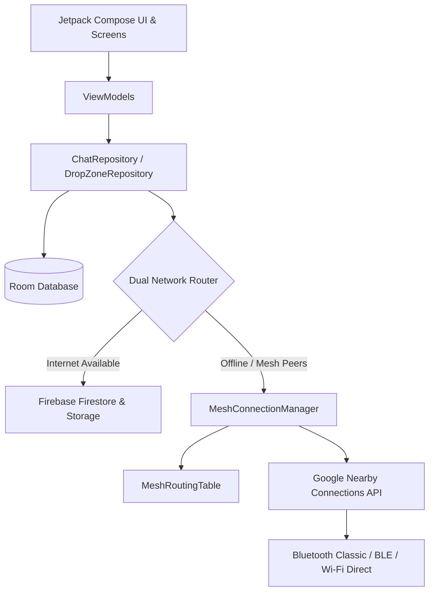

# 🌐 PhantomMesh

> **Decentralized, Off-Grid Mesh & Hybrid Cloud Messenger for Android**

[](https://www.android.com/)
[](https://kotlinlang.org/)
[](https://developer.android.com/jetpack/compose)
[](https://developers.google.com/nearby/connections/overview)
[](LICENSE)

**PhantomMesh** is a privacy-first, disaster-resilient messaging application built for Android. It operates seamlessly in both high-connectivity environments (via Firebase Cloud) and total network blackouts or disaster zones (via decentralized Bluetooth Classic, BLE, and Wi-Fi Direct peer-to-peer mesh networking).

---

## ✨ Key Features

### 📡 Offline Decentralized Mesh Networking
- **Zero-Internet Communication**: Exchange messages and media without Wi-Fi routers, cellular towers, or internet connectivity.
- **Google Nearby Connections (`Strategy.P2P_CLUSTER`)**: High-speed, robust cross-device interoperability (Qualcomm Snapdragon, Samsung Exynos, MediaTek, Google Tensor).
- **Multi-Hop Relay Routing**: Store-and-forward packet propagation across up to 3 hops with loop prevention and Time-To-Live (TTL) enforcement.
- **Dynamic Routing Table**: Automatic peer identity discovery, reachability advertisements, and 1-to-1 routing fallbacks.
- **Priority Data Queue**: Text and control packets (ACK, identity, deletion) transmit instantly, while high-volume media payloads queue for high-bandwidth links.

### 🔄 Dual-Engine Hybrid Cloud & Mesh Handoff
- **Automatic Fallback**: Transparently switches between Firebase (Firestore / Firebase Storage) when internet is active and Nearby Connections P2P Mesh when offline.
- **Delivery Receipts**: Single check (saved/queued), double check (mesh sent / cloud delivered), and blue checks (read/peer ACK confirmed).

### 🗑️ "Delete for Everyone" Across All Media Types
- **Full Media Purge**: Deletes messages from sender and recipient devices.
- **Supported Formats**: Text, images, videos, and voice messages.
- **Deep Clean**: Purges app internal directories (`received_media`, `voice_notes`), Coil in-memory/disk caches, SQLite Room database entries, and external gallery directories via `MediaStore`.
- **Mesh-Wide Deletion Broadcast**: Broadcasts `delete_msg` packets across the mesh to purge relay nodes and peer devices automatically.

### 🎙️ Encrypted Voice Messaging
- Built-in low-latency AAC/M4A voice note recorder and interactive player.
- Live animated waveforms, recording duration timers, and offline mesh transfer support.

### 🗺️ Live Mesh Topology & Proximity Radar
- Interactive real-time network topology visualizer built with Jetpack Compose.
- Radar sweep animations indicating active background scanning.
- Signal strength indicators and direct one-tap private channel initiation.
- Quick-select nearby peer chips on the chat dashboard.

### 🛡️ Duress Decoy Session
- Built-in anti-forensic security: enter a designated Duress PIN at authentication to instantly open a clean decoy session without alerting an adversary.

---

## 🏗️ Architecture & Tech Stack

PhantomMesh follows modern Android architecture patterns (Clean Architecture + MVVM + Unidirectional Data Flow):



- **Language**: Kotlin 1.9+
- **UI Framework**: Jetpack Compose with Material 3 & Custom Neon/Dark Stealth Palette
- **Dependency Injection**: Dagger Hilt
- **Persistence**: Room Database (SQLite) + Encrypted SharedPreferences
- **Asynchronous / Reactive**: Kotlin Coroutines, StateFlow, SharedFlow
- **Media Engine**: Android `MediaRecorder` + `MediaPlayer` + Coil Image Loader
- **Offline Mesh Transport**: Google Play Services Nearby Connections API (`P2P_CLUSTER`)
- **Cloud Backend**: Firebase Authentication, Cloud Firestore, Firebase Cloud Storage

---

## 📱 Hardware & Permission Requirements

PhantomMesh requires the following system permissions to operate the hybrid mesh engine:

| Permission | Purpose |
| :--- | :--- |
| `BLUETOOTH_SCAN` / `BLUETOOTH_ADVERTISE` / `BLUETOOTH_CONNECT` | Bluetooth Classic & BLE mesh discovery/data transfer |
| `NEARBY_WIFI_DEVICES` | Wi-Fi Direct and local hotspot bandwidth upgrades (Android 13+) |
| `ACCESS_FINE_LOCATION` | Required by Android for BLE beacon scanning |
| `RECORD_AUDIO` | High-fidelity voice notes recording |
| `READ_MEDIA_IMAGES` / `READ_MEDIA_VIDEO` / `READ_MEDIA_AUDIO` | Media attachments and gallery export/cleanup |

> ℹ️ **Note**: Location services (GPS) must be enabled on Android devices for Nearby Connections beacon discovery.

---

## 🚀 Getting Started

### Prerequisites
- **Android Studio**: Ladybug (2024.2.1) or newer
- **JDK**: Java 17
- **Min SDK**: API 26 (Android 8.0 Oreo)
- **Target SDK**: API 34 (Android 14)

### Clone the Repository
```bash
git clone https://github.com/sayan2b1/PhantomMesh.git
cd PhantomMesh
```

### Firebase Setup (Optional for Mesh-Only Testing)
1. Create a Firebase project in the [Firebase Console](https://console.firebase.google.com/).
2. Enable **Authentication** (Anonymous or Email), **Cloud Firestore**, and **Cloud Storage**.
3. Download `google-services.json` and place it in the `app/` folder:
   ```
   app/google-services.json
   ```

### Build & Run
You can build the debug APK directly via the Gradle wrapper:

```bash
# On Windows
.\gradlew.bat assembleDebug

# On macOS / Linux
./gradlew assembleDebug
```

The compiled APK will be generated at:
```
app/build/outputs/apk/debug/app-debug.apk
```

Install on connected Android devices:
```bash
adb install -r app/build/outputs/apk/debug/app-debug.apk
```

---

## 🧪 Testing Offline Bluetooth Mesh

1. Install the APK on two physical Android devices (e.g., OnePlus and Samsung).
2. Open **PhantomMesh** on both devices and sign in / set a display name.
3. Turn **Wi-Fi OFF** on both devices and ensure **Bluetooth** and **Location** are turned **ON**.
4. Both devices will automatically discover each other via Nearby Connections.
5. Tap on the discovered peer chip on the home screen or open **Mesh Topology** (`Hub` icon) and tap **CHAT**.
6. Send text, photos, videos, or voice notes — all communication will route 100% peer-to-peer over Bluetooth!

---

## 📄 License

This project is licensed under the MIT License — see the [LICENSE](LICENSE) file for details.
