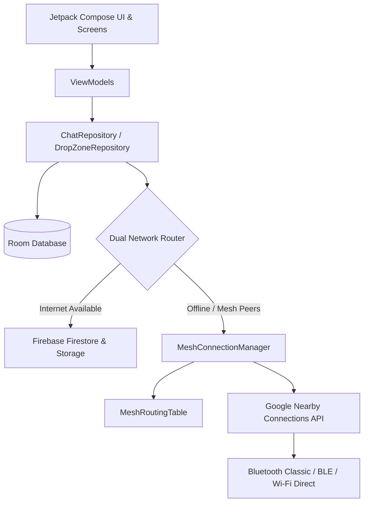

# 🌐 PhantomMesh

> **Decentralized, Off-Grid Mesh & Hybrid Cloud Messenger for Android**

[](https://www.android.com/)
[](https://github.com/sayan2b1/PhantomMesh/releases)
[](https://kotlinlang.org/)
[](https://developer.android.com/jetpack/compose)
[](https://developers.google.com/nearby/connections/overview)
[](LICENSE)

**PhantomMesh** is a privacy-first, disaster-resilient messaging application built for Android. It operates seamlessly in both high-connectivity environments (via Firebase Cloud) and total network blackouts or disaster zones (via decentralized Bluetooth Classic, BLE, and Wi-Fi Direct peer-to-peer mesh networking).

---

## ✨ Key Features

### 📡 Offline Decentralized Mesh Networking
- **Zero-Internet Communication**: Exchange messages and media without Wi-Fi routers, cellular towers, or internet connectivity.
- **Google Nearby Connections (`Strategy.P2P_CLUSTER`)**: High-speed, robust cross-device interoperability (Qualcomm Snapdragon, Samsung Exynos, MediaTek, Google Tensor).
- **Multi-Hop Relay Routing**: Store-and-forward packet propagation across up to 3 hops with loop prevention and Time-To-Live (TTL) enforcement.
- **Dynamic Routing Table**: Automatic peer identity discovery, reachability advertisements, and 1-to-1 routing fallbacks.
- **Priority Data Queue**: Text and control packets (ACK, identity, deletion) transmit instantly, while high-volume media payloads queue for high-bandwidth links.

### 📞 Pure-Kotlin VoIP Voice & Video Calling Engine
- **Voice Calling Across All Transports**: Low-bandwidth VoIP voice calling is fully operational across **all networks (Bluetooth Mesh, Wi-Fi Direct LAN P2P, and Cloud Relay)** without requiring cellular towers or internet.
- **Pure-Kotlin Video Pipeline**: Utilizes custom `CameraVideoEngine` with main-thread frame sampling and background compression, eliminating native WebRTC C++ surface collisions and SIGSEGV/SIGABRT crashes on modern Android devices (Android 14+, Samsung Galaxy F34, OnePlus 11R).
- **Sub-5ms Local Wi-Fi LAN Mode**: Direct UDP peer-to-peer audio and video transmission when connected to the same Wi-Fi network.
- **45-Second Outgoing Call Timeout**: Automated call ring timeout transitions unanswered outgoing calls cleanly without hanging indefinitely.
- **In-Call Overlay & Controls**: Full-screen calling UI with animated audio wave pulses, speakerphone toggle, microphone mute, camera flipper, and active call duration timer.

### 📊 Dedicated Call History Hub & Analytics
- **Detailed Call Metrics**:
  - **Time of Calling**: Clean timestamps with clock icons (`Today, 10:45 AM`, `Yesterday, 04:20 PM`, or `Oct 29, 09:15 AM`).
  - **Call Duration**: Formatted in monospace (`2m 45s`, `45s`, `1h 12m 30s`) for all completed calls.
  - **Incoming / Outgoing Direction**: Visual directional arrows and labels (`Incoming` in green, `Outgoing` in cyan).
  - **Granular Status Badges**: Specific color-coded badges for **Completed**, **Missed Call** (Crimson), **Call Declined** (Amber), **Not Answered** (Warm Amber), and **Not Connected** (Red).
  - **Call Type Identification**: Visual chips indicating **`[AUDIO]`** (green) or **`[VIDEO]`** (cyan) with matching avatar icons.
- **Interactive Filter Tabs**: Filter call records instantly between **ALL** and **MISSED / UNANSWERED**.
- **One-Tap Quick Callback**: Direct audio or video redial buttons on every call record.
- **Call Management**: Delete individual call logs or clear full call history with confirmation dialogs.

### 💬 Swipe-to-Reply & Quoted Context
- **Fluid Gesture Control**: Swipe right on any message bubble with a smooth spring animation and haptic vibration feedback.
- **Quoted Message Context**: Displays an active reply preview bar above the input box and embeds the quoted sender and snippet inside the sent message bubble.

### 🔊 WhatsApp-Style Instant Audio Feedback
- **Zero-Latency Synthetic PCM**: Pure synthesized audio tones for outgoing message "pop", incoming message chime, and call ringtones without external asset overhead.

### 🔐 Account Recovery via 30 Deep Security Questions
- **Introspective Security Questions**: 30 complex, thoughtful questions during user registration that cannot be easily guessed by acquaintances.
- **PBKDF2 Cryptographic Hashing**: Security question answers are salted and hashed client-side using PBKDF2 with SHA-256 (10,000 iterations).
- **Two-Step Password Reset**: Seamless forgot password dialog with answer verification and instant password update.

### 🔄 Dual-Engine Hybrid Cloud & Mesh Handoff
- **Automatic Fallback**: Transparently switches between Firebase (Firestore / Firebase Storage) when internet is active and Nearby Connections P2P Mesh when offline.
- **Delivery Receipts**: Single check (saved/queued), double check (mesh sent / cloud delivered), and blue checks (read/peer ACK confirmed).

### 🎵 WhatsApp-Style Audio & Music Sharing
- **Device-Wide Audio Browser**: Seamlessly scans device storage via Android's `MediaStore` without navigating messy file picker directories.
- **Instant Pre-Send Audio Preview**: Built-in Play/Pause player (`▶` / `⏸`) directly in the selection list to listen to songs and recordings before sending.
- **Track Metadata & Search**: Displays song titles, duration, and file size (`00:14 • 296 kB`) with real-time title search filtering.
- **In-Bubble Audio Track Player**: Neon-styled chat bubble with glowing progress track, audio tags, and mutually exclusive playback with voice notes.

### 📎 Categorized Attachment Hub
- **Photos & Videos**: Visual Media Picker filtered by device albums.
- **Music**: Direct WhatsApp-style audio track browser with pre-send audio preview.
- **Documents**: System file picker for documents, PDFs, and archives.
- **Contacts**: Phonebook picker sharing contacts as interactive cards with one-tap dialing.

### 🏷️ Custom Contact Naming & Dual Display
- **Custom Nicknames**: Assign personalized names to any peer (e.g. `Sayan Dolai (sayan2b1)`).
- **Dual Display Everywhere**: Both custom alias and network username appear together across chat headers, conversation lists, nearby peer chips, and push notifications.
- **Live Edit**: Tap on the contact name inside the chat or long-press any conversation in the chat list to update or reset custom aliases with live previews.

### 🛡️ Synchronized 3-Tier Delivery & Read Receipts
- **Accurate 3-State Delivery Tracking**:
  - **1 Gray Check**: Stored in local database and dispatched (`saved` / `mesh_sent`).
  - **2 Gray Checks**: Delivered to recipient device and local notification generated (`delivered`).
  - **2 Bright Cyan Checks**: Recipient opened the chat and read the message (`read`).
- **Clock-Skew Tolerant Synchronization**: Timestamp-bounded database queries (`markSentMessagesAsReadBefore`, `markSentMessagesAsDeliveredBefore`) prevent newly sent messages from prematurely turning blue.
- **Dual-Channel Delivery Sync**: Automatically bridges delivery receipts across both Bluetooth/Wi-Fi Direct mesh ACKs and Firestore cloud listeners.
- **Read Receipts Toggle**: Opt-in/out of read receipts under *Settings ➔ Privacy & Security*. When disabled, checkmarks remain neutral gray.

### 🧹 Chat & Contact Management
- **Clear Chat**: Clear conversation message history for any contact directly from the in-chat dropdown menu.
- **Delete Contact / Conversation**: Remove any chat directly from the home screen / conversation list.
- **Chronological Sorting**: Conversations automatically sort in real-time with the most recent message anchored at the very top.
- **Archive & Mute**: Archive low-priority chats or mute notifications on a per-contact basis.

### 🚫 Contact Blocking & Do Not Disturb (DND) Suite
- **One-Tap Contact Blocking**: Block unwanted contacts directly from the chat screen menu. Incoming messages and call offers from blocked users are silently discarded.
- **Blocked Contacts Manager**: View total blocked count under *Settings ➔ Privacy & Security* with individual **UNBLOCK** action pills.
- **Do Not Disturb (DND) Mode**: Global toggle silences all message popups, call ringtones, and notification sounds while keeping messages quietly recorded.

### 💬 Unread Message Counters, Dividers & Real-Time Auto-Scroll
- **Conversation List Badges**: High-contrast unread count badges highlight chats with unread messages.
- **In-Chat Unread Divider**: A dedicated banner (`——— ● N UNREAD MESSAGES ———`) clearly separates previously read messages from new ones.
- **`NEW` Badges & Glowing Accents**: Unread message bubbles feature a distinct `NEW` tag and subtle neon accent borders.
- **Real-Time Chat Auto-Scroll**: Opening a conversation anchors to the latest message at the bottom. When chatting, new incoming and outgoing messages smoothly scroll into view with physics animations.
- **Dynamic Keyboard (IME) Pinning**: Automatically keeps the latest messages visible immediately above the keyboard when typing.

### 💾 Signal-Style Encrypted Local Chat Backup & Restore
- **In-Place Append & Rewrite**: Backs up entire message history and chats into a single encrypted file (`phantom_mesh_backup_latest.enc`) without creating duplicate files or cluttering storage.
- **AES-256-GCM & PBKDF2**: Military-grade client-side encryption protected with custom master passwords.
- **Automated Background Scheduling**: Android `WorkManager` automated backups with customizable frequencies:
  - *Daily*, *Weekly*, *Bi-Weekly*, or *Manual Only*.
- **Instant One-Tap Restore**: Restore complete chat histories across app reinstalls or new devices.

### 🎨 Custom Chat Appearance & Theming
- **Custom Bubble Color Palettes**: Select custom background colors for sender and receiver bubbles from curated palettes (Neon Cyan, Cyber Green, Matrix Green, Royal Blue, Deep Purple, Crimson Red, Gold Amber, and Stealth Dark variants).
- **Adaptive Font Style**: Option to use **Device Default** (dynamically inherits the user's phone native typography, such as Samsung One, OnePlus Sans, Google Sans, or Roboto), **Monospace**, **Sans-Serif**, or **Serif**.
- **Adjustable Text Size**: Choose between *Small (13sp)*, *Medium (15sp)*, *Large (17sp)*, and *Extra Large (19sp)* with real-time live preview.
- **Personalized Chat Backgrounds**: Set custom wallpaper images from device gallery with automatic 55% dark scrim overlay for optimal contrast.

### ⚡ Adaptive Display Refresh Rate (60Hz / 90Hz / 120Hz / Max)
- **High-Refresh Display Support**: Dynamically detects hardware display capabilities and switches display modes for high-refresh devices (OnePlus, Samsung Galaxy, Pixel, Xiaomi).
- **User-Selectable Frequencies**: Force **60 Hz** (battery saving), **90 Hz** (balanced), **120 Hz** (ultra-smooth scrolling), or **Adaptive / Device Max**.

### ⚙️ Modular Settings Architecture
- Organized into dedicated sub-pages for zero-clutter navigation:
  - 🎨 **Chat Appearance** (Wallpaper, Bubble Colors, Device Font, Text Size)
  - 🛡️ **Privacy & Security** (Read Receipts Toggle, Decoy Passphrase, Nuclear Wipe)
  - ⚡ **Display & Refresh Rate** (Hardware capabilities, refresh rate selector)
  - 💾 **Chat Backup and Restore** (In-place rewrite, auto-backup schedule, restore)
  - 👤 **Account & Credentials** (Change username & password)
  - 🚨 **Emergency Decoy** (Duress PIN & stealth decoy mode)

### 🔔 Smart Background & In-App Notifications
- **High-Priority Heads-Up Channel**: Message alerts with sound and vibration even when the app is in the background or device is locked.
- **Sender Aliasing**: Notification titles automatically reflect custom contact nicknames.
- **Active Chat Suppression**: Intelligently suppresses notifications for the currently open chat to eliminate notification noise during active conversations.

### 🗑️ "Delete for Everyone" Across All Media Types
- **Full Media Purge**: Deletes messages from sender and recipient devices.
- **Supported Formats**: Text, images, videos, audio tracks, and voice messages.
- **Deep Clean**: Purges app internal directories (`received_media`, `voice_notes`), Coil in-memory/disk caches, SQLite Room database entries, and external gallery directories via `MediaStore`.
- **Mesh-Wide Deletion Broadcast**: Broadcasts `delete_msg` packets across the mesh to purge relay nodes and peer devices automatically.

### 🎙️ Encrypted Voice Messaging
- Built-in low-latency AAC/M4A voice note recorder and interactive player.
- Live animated waveforms, recording duration timers, and offline mesh transfer support.

### 🗺️ Live Mesh Topology & Proximity Radar
- Interactive real-time network topology visualizer built with Jetpack Compose.
- Radar sweep animations indicating active background scanning.
- Signal strength indicators and direct one-tap private channel initiation.
- Quick-select nearby peer chips on the chat dashboard.

### 🛡️ Duress Decoy Session
- Built-in anti-forensic security: enter a designated Duress PIN at authentication to instantly open a clean decoy session without alerting an adversary.

---

## 🏗️ Architecture & Tech Stack

PhantomMesh follows modern Android architecture patterns (Clean Architecture + MVVM + Unidirectional Data Flow):



- **Language**: Kotlin 1.9+
- **UI Framework**: Jetpack Compose with Material 3 & Custom Neon/Dark Stealth Palette
- **Dependency Injection**: Dagger Hilt
- **Persistence**: Room Database (SQLite) + Encrypted SharedPreferences + DataStore
- **Asynchronous / Reactive**: Kotlin Coroutines, StateFlow, SharedFlow
- **Media Engine**: Android `MediaRecorder` + `MediaPlayer` + Coil Image Loader + `MediaStore` API
- **Offline Mesh Transport**: Google Play Services Nearby Connections API (`P2P_CLUSTER`)
- **Cloud Backend**: Firebase Authentication, Cloud Firestore, Firebase Cloud Storage, Firebase Cloud Messaging

---

## 📱 Hardware & Permission Requirements

PhantomMesh requires the following system permissions to operate the hybrid mesh engine:

| Permission | Purpose |
| :--- | :--- |
| `BLUETOOTH_SCAN` / `BLUETOOTH_ADVERTISE` / `BLUETOOTH_CONNECT` | Bluetooth Classic & BLE mesh discovery/data transfer |
| `NEARBY_WIFI_DEVICES` | Wi-Fi Direct and local hotspot bandwidth upgrades (Android 13+) |
| `ACCESS_FINE_LOCATION` | Required by Android for BLE beacon scanning |
| `RECORD_AUDIO` | High-fidelity voice notes recording |
| `READ_MEDIA_AUDIO` / `READ_EXTERNAL_STORAGE` | WhatsApp-style device audio track scanning and playback |
| `READ_MEDIA_IMAGES` / `READ_MEDIA_VIDEO` | Media attachments and gallery export/cleanup |
| `READ_CONTACTS` | Device contact card sharing with dial actions |
| `POST_NOTIFICATIONS` | High-priority incoming message notifications (Android 13+) |

> ℹ️ **Note**: Location services (GPS) must be enabled on Android devices for Nearby Connections beacon discovery.

---

## 🚀 Getting Started

### Prerequisites
- **Android Studio**: Ladybug (2024.2.1) or newer
- **JDK**: Java 17
- **Min SDK**: API 31 (Android 12)
- **Target SDK**: API 35 (Android 15)

### Clone the Repository
```bash
git clone https://github.com/sayan2b1/PhantomMesh.git
cd PhantomMesh
```

### Firebase Setup (Optional for Mesh-Only Testing)
1. Create a Firebase project in the [Firebase Console](https://console.firebase.google.com/).
2. Enable **Authentication** (Anonymous or Email), **Cloud Firestore**, and **Cloud Storage**.
3. Download `google-services.json` and place it in the `app/` folder:
   ```
   app/google-services.json
   ```

### Build & Run
You can build the debug APK directly via the Gradle wrapper:

```bash
# On Windows
.\gradlew.bat assembleDebug

# On macOS / Linux
./gradlew assembleDebug
```

The compiled APK will be generated at:
```
app/build/outputs/apk/debug/app-debug.apk
```

Install on connected Android devices:
```bash
adb install -r app/build/outputs/apk/debug/app-debug.apk
```

---

## 🧪 Testing Offline Bluetooth Mesh

1. Install the APK on two physical Android devices (e.g., OnePlus and Samsung).
2. Open **PhantomMesh** on both devices and sign in / set a display name.
3. Turn **Wi-Fi OFF** on both devices and ensure **Bluetooth** and **Location** are turned **ON**.
4. Both devices will automatically discover each other via Nearby Connections.
5. Tap on the discovered peer chip on the home screen or open **Mesh Topology** (`Hub` icon) and tap **CHAT**.
6. Send text, photos, videos, audio tracks, or voice notes — all communication will route 100% peer-to-peer over Bluetooth!

---

## 📄 License

This project is licensed under the MIT License — see the [LICENSE](LICENSE) file for details.
